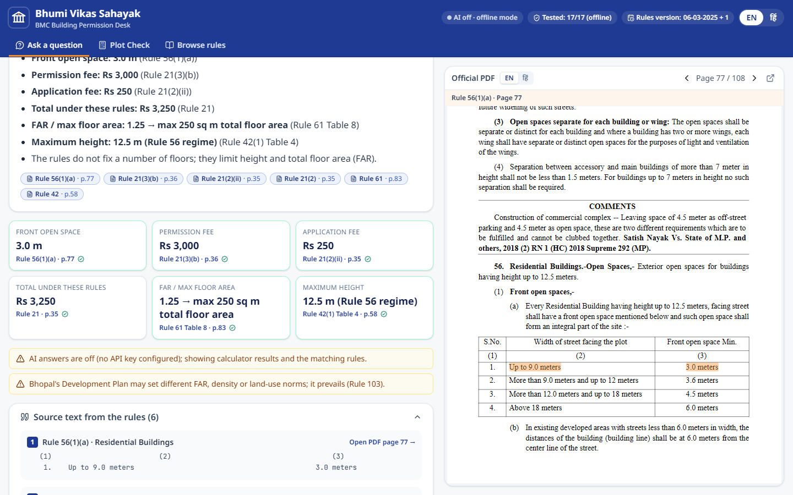
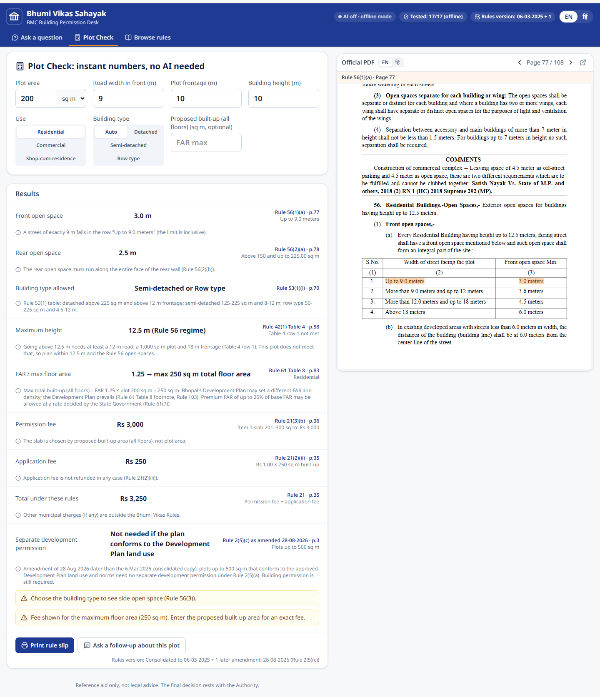
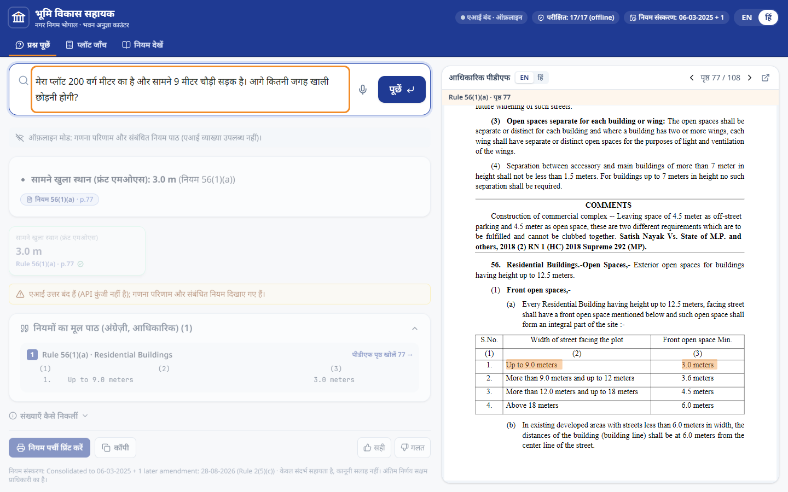
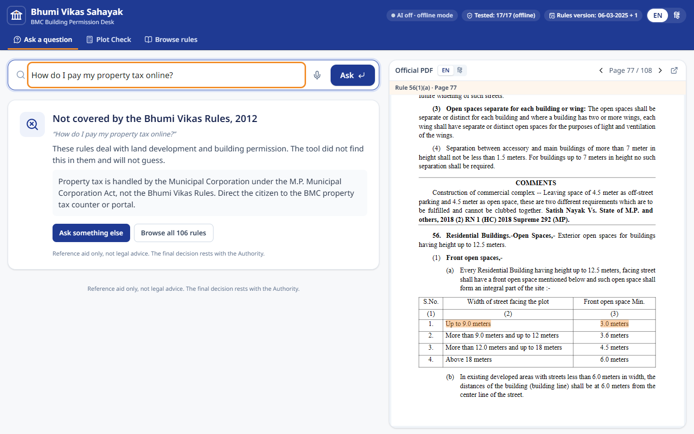
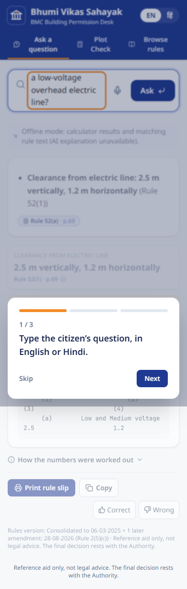

# Bhumi Vikas Sahayak (भूमि विकास सहायक)

**Ask the Bhopal building rulebook and get an answer you can trust: rule number, exact text, PDF page.**

> **Track 1 · Claude Impact Lab × Cerebras Café Compute, Bhopal · 11 Oct 2026**
> **Team:** _<team name>_ · **Members:** _<names>_
> **The one user we built for:** a building-permission clerk at the **Bhopal Municipal Corporation** counter.

| | |
|---|---|
| ✅ `python verify.py` | data integrity · secret scan · **124 backend tests** · accuracy eval → `verify_report.json` |
| 🧠 AI provider | **Google Gemini** (`gemini-3.8-flash`, default) or **Anthropic Claude**, chosen by one setting; every quote is verified word for word against the rules |
| 🎯 Sample questions | **17 / 17** offline mode (see [Accuracy](#accuracy) for caveats); AI mode needs an API key to measure |
| 🌐 Languages | English and Hindi (UI, questions, answers) |
| 🚀 Deploy | One Docker container: Render / Railway / any VM, see [Deploy](#deploy) |
| 🔌 Works without AI | Plot Check, rule browser and offline answers run with no API key or internet |
| 🤖 For AI evaluators | Start with **[AGENTS.md](AGENTS.md)**; requirement-by-requirement proof in **[docs/REQUIREMENTS_TRACE.md](docs/REQUIREMENTS_TRACE.md)** |



---

## Contents
1. [The problem](#the-problem)
2. [What the tool does](#what-the-tool-does)
3. [Quick start (5 steps)](#quick-start-5-steps)
4. [Verify everything in one command](#verify-everything-in-one-command)
5. [How it works](#how-it-works)
6. [Accuracy](#accuracy)
7. [Deploy](#deploy)
8. [Using it from the command line and the API](#using-it-from-the-command-line-and-the-api)
9. [Project structure](#project-structure)
10. [Configuration](#configuration)
11. [What works and what doesn't](#what-works-and-what-doesnt)
12. [Data sources](#data-sources)
13. [Keeping the rules up to date](#keeping-the-rules-up-to-date)
14. [Tech stack](#tech-stack)
15. [Licence](#licence)

---

## The problem

Every house, shop or extra floor in Bhopal must follow the **MP Bhumi Vikas Rules, 2012**: 108 pages and 105 numbered rules. The numbers people ask about most (setbacks, fees, floor-area limits) sit in **tables that are easy to misread**. The rules **keep changing**: the consolidated copy stops on 6 Mar 2025, and Rule 2(5)(c) changed again on **28 Aug 2026**. Citizens ask in **English and Hindi**, and the official Hindi PDF uses an old font that copies out as garbage.

A clerk at the counter hears the same questions all day:

> *"My plot is 200 sq m on a 9 m road. How much gap do I leave at the front, how many floors can I build, and what fee do I pay?"*

They need a **correct answer within a minute, with the rule number to show the citizen**, and the tool must **say "not found" instead of guessing** when the rules are silent.

## What the tool does

| | Feature | Why it matters at the counter |
|---|---|---|
| 💬 | **Ask in English or Hindi** → short answer in the same language, streamed in seconds | No reading 108 pages |
| 📌 | **Every claim cites its rule, sub-rule, exact quote and PDF page**. Quotes are checked word for word against the rule text; anything not found is removed | The clerk can show the citizen the rule |
| 📄 | **Official PDF opens beside the answer on the cited page, with the table row highlighted** | Check against the source of truth in one click |
| 🧮 | **Table numbers are computed by tested code**, not by the AI: setbacks, fees, FAR, height norms, electric-line clearances, validity, farm-house norms | Tables are where mistakes happen |
| 🔍 | **Number check**: any number in the answer that isn't in a quote, a calculation or the question is flagged ⚠ | Catches a misread table |
| 🚫 | **"Not covered by these rules"** for property tax, land rates, registry… with where to go instead | Never invents a rule |
| 🗓 | **Rules-version badge + amendment banner** (28-08-2026, Rule 2(5)(c): plots ≤ 500 sq m) | The clerk knows which version the answer uses |
| 🏠 | **Plot Check**: type plot area, road width, frontage, height and use → all numbers instantly, **no AI needed** | The most common counter question, answered offline |
| 📚 | **Browse all 106 rules**: clean text by PDF page, amendment notes, court notes kept separate | For when the clerk wants to read |
| 🖨 | **Printable A5 rule slip** for the citizen (no personal data) | The citizen leaves with the rule numbers |
| 🛡 | Personal data (phones, emails, IDs) masked before logging; disclaimer on every answer | Safe for a government counter |

<table>
<tr>
<td width="50%"><br/><sub>Plot Check: every number with its rule, table row and page</sub></td>
<td width="50%"><br/><sub>Hindi question → Hindi answer, official English quote, PDF page</sub></td>
</tr>
<tr>
<td><br/><sub>Honest "not covered" answer for property tax</sub></td>
<td><br/><sub>Also works on a phone or tablet</sub></td>
</tr>
</table>

## Quick start (5 steps)

Requirements: **Python 3.12+** and **Node 20+**.

```bash
# 1. get the code
git clone https://github.com/PriyanshuRaj2077/Bhumi-Vikas-Sahayak.git && cd Bhumi-Vikas-Sahayak
# 2. configuration (optional: without a key the app runs in offline mode)
cp .env.example .env          # then put GEMINI_API_KEY=... in .env (or ANTHROPIC_API_KEY with LLM_PROVIDER=anthropic)
# 3. install and build
pip install -r backend/requirements.txt && (cd frontend && npm install && npm run build)
# 4. run
cd backend && python -m uvicorn app.main:app --port 8000
# 5. open http://localhost:8000
```

**Docker:** `cp .env.example .env && docker compose up --build`, then open http://localhost:8000 (the Dockerfile was not tested on the build machine). To put it online, see [Deploy](#deploy).
**Frontend dev mode:** run the backend on port 8000, then `cd frontend && npm run dev` (Vite proxies `/api` and `/pdf`).

## Verify everything in one command

```bash
python verify.py              # ~10 s, no network
python verify.py --frontend   # + type-check and build the React app
python verify.py --ai         # + accuracy eval in AI mode (needs GEMINI_API_KEY or ANTHROPIC_API_KEY)
```
Output on the build machine:
```
PASS  data_integrity       106 rules, 1 amendment(s)
PASS  no_secrets_in_repo
PASS  backend_tests        124 passed, 0 failed
PASS  eval_offline         17/17 sample questions correct (offline mode); all 30/30
PASS  frontend_build

ALL CHECKS PASSED -> verify_report.json
```
Browser test (uses the installed Microsoft Edge): `cd e2e && npm install && node smoke.mjs` (server running). It checks the headline answer, the PDF page highlight, not-found, Hindi, Plot Check, the amendment banner, the mobile layout and that there are no console errors.

## How it works

```
                 ┌──────────────────────────── FastAPI (one process) ─────────────────────────────┐
 Clerk ─▶ React ─┤ Router ─────────▶ Answer engine: Gemini (default) or Claude                     │
   UI     (SSE)  │ • language EN/HI   • whole rulebook in context (cached); quotes verified/cited     │
                 │ • plot facts       • 11 strict tools ─▶ Calculators (Rules 17,21,23,42,52,53,   │
                 │   (sq m/sq ft,                                           56,61, 2(5)(c))      │
                 │    Hindi digits)  ─▶ Offline path (no key / no internet): calculators + BM25    │
                 │ • out-of-scope                                                                 │
                 │ • PII masking     ─▶ Verifier: no citation ⇒ NOT FOUND · numbers must appear in │
                 │                      quote / calculation / question · amendment banner · version│
                 └────────────────────────────────────────────────────────────────────────────────┘
```

1. **The data is cleaned once at startup** (`backend/app/corpus.py`). The participant-pack JSONL has page headers, court case notes and amendment footnotes mixed into the rule text. Running headers (`Rule 56   M.P. Bhumi Vikas Rules, 2012   78`) are removed, and their page number gives an **exact character → PDF page map**. Court "COMMENTS" are split out as *court notes (not rules)*. Amendment footnotes become metadata. Inserted rules resolve to their parent (17-a → 17, 42-A → 42).
2. **The whole book goes to the model, no vector search.** The cleaned rules are ~270K characters (about 75K tokens), so they fit in one stable, cacheable prefix. Nothing can be missed by retrieval.
3. **Citations, not claims.** The two providers get the same guarantee in different ways:
   - **Gemini** (`llm/gemini_engine.py`) must return its answer as JSON with `[n]` markers and quotes copied from the rules. `llm/quotes.py` searches each quote in the cleaned text, ignoring whitespace. A quote that isn't found is **deleted along with its marker**, with a warning. Found quotes are mapped to **rule, sub-rule and exact page** by the backend, never by the model.
   - **Claude** (`llm/engine.py`) uses the native Citations API, which returns exact character spans. `llm/documents.py` maps them the same way.
4. **Numbers from code.** The prompt forbids reading table numbers. Claude calls tools such as `rear_open_space(plot_area_sqm=150)`, backed by `calculators/core.py`. Every table row there carries a **verbatim snippet of the rule text**, and tests assert that each snippet exists and each page number matches.
5. **Verifier** (`verify.py` in the backend):
   - no citations or a `NOT_FOUND` reply → "not covered" card;
   - numbers not found in a quote or calculation → ⚠ flag and `confidence: check`;
   - a cited clause changed by a later amendment → amber banner;
   - every answer carries the rules version and a disclaimer.
6. **Offline fallback.** With no API key or no internet, the same calculators run on detected intents, plus BM25 keyword search (with a Hindi glossary) returns the best rule passage.

More detail: [docs/03-backend-architecture.md](docs/03-backend-architecture.md) · UX: [docs/04-frontend-design.md](docs/04-frontend-design.md) · Research and answer key: [docs/01-research.md](docs/01-research.md)

## Accuracy

The evaluation set is [`eval/gold.jsonl`](eval/gold.jsonl): the **17 official sample questions** (S01–S17, including 2 in Hindi and 2 that must be "not found") plus **13 extra counter cases** (T01–T13: slab boundaries, commercial fees, 11 kV lines, tall buildings on small plots, Hindi). Each item states the expected rules, the exact numbers, the numbers that would be **wrong** (e.g. 3.6 m for a 9 m road) and, where relevant, the expected amendment banner.

| Mode | Sample (17) | All (30) | Status |
|---|---|---|---|
| **Offline** (calculators + keyword search, no AI) | **17/17** | **30/30** | Measured. ⚠ Its keyword rules were tuned on these same questions, so this is an upper bound for new phrasings. |
| **AI** (Gemini or Claude + calculators + verified quotes) | n/a | n/a | **Not measured yet**: the build machine had no API key. Set `GEMINI_API_KEY` and run `python verify.py --ai`. |

Per-question results: [`eval/results/offline.md`](eval/results/offline.md) · machine-readable: `eval/results/latest.json`.

Answer key highlights (checked against the PDF): 9.0 m road → **3.0 m** front (Rule 56(1)(a)); 10 m road → **3.6 m**; 150 sq m plot → **1.5 m** rear (56(2)(a)); fee goes by **built-up** slab, e.g. 250 sq m → **Rs 3,000** + Rs 250 application fee (21(3)(b), 21(2)(ii)); low-voltage line → **2.5 m vertical, 1.2 m horizontal** (52); farm house → **0.40 ha, FAR 0.10** (17); permission → **3 years + two 1-year renewals** (23); DP conflicts → **Rule 103**; the rules **don't fix a number of floors**, they limit height (12.5 m regime) and FAR (1.25).

## Deploy

The app is **one Docker container** that serves the API, the official PDFs and the built UI on one port (it reads `$PORT`). Nothing else is needed: no database server, no vector DB.

### Render (free tier, easiest)
1. https://render.com → sign in with GitHub → **New → Web Service** → pick this repository.
2. Runtime: **Docker**. Instance: **Free**. Health check path: **`/healthz`**.
3. **Environment variables**: `LLM_PROVIDER=gemini`, `GEMINI_API_KEY=<your key>`, `MAX_QUESTIONS_PER_DAY=300`.
4. **Create Web Service**. After the build (~5 min) the app is live at `https://<name>.onrender.com`.
5. Check `https://<name>.onrender.com/healthz` → `"rules": 106, "ai_available": true, "provider": "gemini"`.

The free tier sleeps after 15 min without visitors (the first request then takes ~40 s), so open the link before a demo. The SQLite question log resets on restart.

### Railway
**New Project → Deploy from GitHub repo**, add the same variables under **Variables**, then **Settings → Networking → Generate Domain**.

### Any Linux VM (e.g. a state data-centre server)
```bash
git clone https://github.com/PriyanshuRaj2077/Bhumi-Vikas-Sahayak.git && cd Bhumi-Vikas-Sahayak
cp .env.example .env && nano .env            # set GEMINI_API_KEY
docker compose up -d --build                  # serves on port 8000; put nginx/Caddy in front for HTTPS
```

Never commit the key: set it only in the host's environment settings or in `.env`.

## Using it from the command line and the API

**CLI** (prints JSON; add `--text` to `ask` for plain text):
```bash
cd backend
python -m app.cli ask "My plot is 200 sq m on a 9 m road. Front gap, floors and fee?"
python -m app.cli ask "बिल्डिंग परमिशन की फीस कितनी है और किस नियम में लिखी है?"
python -m app.cli plot-check --plot 200 --road 9 --frontage 10 --height 10 --type semi_detached
python -m app.cli calc electric_clearance '{"line_type": "high_upto_33kv"}'
python -m app.cli rule 17-a
python -m app.cli search "lift"
python -m app.cli tools      # JSON schemas of all calculator tools
python -m app.cli meta
```

**HTTP API** (interactive docs at `http://localhost:8000/docs`):

| Method | Path | Purpose |
|---|---|---|
| POST | `/api/ask/json` | `{"question", "lang": "auto"\|"en"\|"hi"}` → one JSON answer (best for scripts and agents) |
| POST | `/api/ask` | Same pipeline as a Server-Sent Events stream: `start`, `delta`, `tool`, `final` (used by the UI) |
| POST | `/api/plot-check` | Plot facts → all numbers (no AI) |
| POST | `/api/calc` | `{"name", "args"}` → run one calculator |
| GET | `/api/rules`, `/api/rules/{id}` | List rules / one rule (aliases like `17-a` work) |
| GET | `/api/search?q=` | Keyword search |
| GET | `/api/meta` | Rules version, amendments, AI availability, eval summary, recent questions |
| POST | `/api/feedback` | 👍/👎 on an answer |
| GET | `/pdf/en`, `/pdf/hi` | Official PDFs |
| GET | `/healthz` | Liveness |

Example answer (abridged):
```json
{
  "status": "answered", "mode": "ai", "lang": "en",
  "answer_md": "Leave at least 1.5 m at the rear. [1]",
  "facts": [{"label": "Rear open space", "display": "1.5 m", "rule": "56", "sub_rule": "(2)(a)", "page": 78,
             "row_label": "Above 40.00 and up to 150.00 sq m", "quote": "2.     Above 40.00 and up to 150.00   1.50"}],
  "citations": [{"n": 1, "rule": "56", "sub_rule": "(2)(a)", "page": 78, "quote": "…", "pdf_url": "/pdf/en#page=78"}],
  "amendments": [], "warnings": [], "unverified_numbers": [], "confidence": "high",
  "rules_version": "Consolidated to 06-03-2025 + 1 later amendment: 28-08-2026 (Rule 2(5)(c))",
  "disclaimer": "Reference aid only, not legal advice. The final decision rests with the Authority."
}
```
The full field reference is in [AGENTS.md](AGENTS.md#answer-object-same-for-cli-ask-apiaskjson-and-the-final-sse-event).

## Project structure

```
├── AGENTS.md / CLAUDE.md / llms.txt   guides for AI agents
├── verify.py                          one-command verification → verify_report.json
├── backend/
│   ├── app/
│   │   ├── main.py                    FastAPI app + ask pipeline (ask_events / ask_once)
│   │   ├── cli.py                     JSON command-line interface
│   │   ├── router.py                  language, plot facts, out-of-scope, PII masking
│   │   ├── corpus.py                  rule cleaning, page map, sub-rules, aliases, amendments
│   │   ├── calculators/core.py        rule tables + deterministic calculators
│   │   ├── llm/                       documents, prompt, tools, engine.py (Claude), gemini_engine.py, quotes.py (quote verifier)
│   │   ├── verify.py                  trust layer
│   │   ├── offline.py, search.py      no-AI answers, BM25 search
│   │   └── store.py                   SQLite log + feedback (no personal data)
│   ├── data/                          rules JSONL, official PDFs, amendments.json, Hindi glossary
│   └── tests/                         124 tests
├── frontend/src/                      React UI (App, AskView, AnswerPanel, PlotCheck, BrowseRules, PdfPane, PrintSlip)
├── eval/                              gold questions, scorer, results
├── e2e/smoke.mjs                      browser test (Edge via Playwright)
└── docs/                              research, plan, architecture, UX, requirements trace, screenshots
```

## Configuration

Set in `.env` (see [.env.example](.env.example)):

| Variable | Default | Meaning |
|---|---|---|
| `LLM_PROVIDER` | `auto` | `gemini`, `anthropic`, or `auto` (whichever key is set; Anthropic first). No key at all → offline mode |
| `GEMINI_API_KEY` | (empty) | Google AI Studio key (`GOOGLE_API_KEY` also accepted) |
| `GEMINI_MODEL` | `gemini-3.8-flash` | Gemini model ID |
| `ANTHROPIC_API_KEY` | (empty) | Claude key (optional alternative) |
| `MODEL` | `claude-opus-5-5` | Claude model ID |
| `EFFORT` | `low` | Claude thinking effort: lower is faster |
| `USE_FALLBACKS` | `1` | Server-side refusal fallback (Claude API only; set 0 on Bedrock/Vertex/Foundry) |
| `PREWARM` | `0` | Re-warm the rulebook prompt cache every 4 min during office hours |
| `MAX_QUESTIONS_PER_DAY` | `2000` (`.env.example` sets 300) | Cost guard for AI questions; beyond it, offline answers |

## What works and what doesn't

**Works (tested):**
- Ask (EN/HI) with streamed answers, citations, rule badges, PDF page + highlight, "how the numbers were worked out", copy, print slip, feedback.
- Calculators for Rules 17/17-a, 21 (all fee items, high-rise, development fee), 23, 42 Tables 4 and 5, 52, 53(1), 56(1)–(3), 61 Table 8, and the 2(5)(c) amendment, with every row and boundary unit-tested against the rule text.
- Not-found handling, version badge, amendment banner (only when the amended clause is involved), PII masking.
- Plot Check, rule browser, offline mode, mobile layout, onboarding, keyboard shortcuts (`/` focus, `Enter` ask, `Esc` clear).

**Doesn't, or not verified yet:**
- **AI mode has not been run against a live API** (no key on the build machine), for Gemini or for Claude. Both engines are tested with fake clients: tool loop, quote/citation mapping, removal of fabricated quotes, not-found gate, number check and fallback to offline on errors (`tests/test_gemini.py`, `tests/test_engine.py`). First step after adding your key: `python verify.py --ai`, then check a few answers by hand.
- Gemini support uses the `google-genai` SDK's `generate_content` function-calling loop. If Google changes that API, `llm/gemini_engine.py` is the only file to adapt.
- Hindi answers are generated from the English text. Quotes stay in English (the official source). The Hindi PDF opens at the same page number, but its page alignment was not verified page by page.
- Sub-rule labels are best-effort in very long rules (e.g. the Rule 2 definitions).
- The 28-08-2026 amendment comes from a public summary without a Gazette number. An officer should verify it against the M.P. Rajpatra.
- The Bhopal Development Plan can override FAR and density (Rule 103). The app warns but has no DP zone data.
- Offline answers give calculator results and the best rule passage, not a written explanation.
- The Docker setup was not tested (no Docker on the build machine).

## Data sources

| Data | Source |
|---|---|
| Rules JSONL, full text by page, sample questions | Participant pack: https://github.com/Vishal4742/bhopal-impact-lab-2026-problem-statements (originally https://github.com/Laaaaksh/bhopal-impact-lab-2026) |
| MP Bhumi Vikas Rules 2012, consolidated to 06-03-2025, English (source of truth) | https://mptownplan.gov.in/NewsPDF/bvn06032025E.pdf |
| Same, Hindi | https://mptownplan.gov.in/NewsPDF/bvn06032025H.pdf |
| **Extra:** 28-08-2026 amendment to Rule 2(5)(c) | https://teamleaseregtech.com/updates/article/59469/government-of-madhya-pradesh-amendment-to-land-development-rules |

No personal data is used or stored. There is no connection to any government system.

## Keeping the rules up to date

1. Add the amendment to [`backend/data/amendments.json`](backend/data/amendments.json): rule, clause, date, source, text, English and Hindi summary.
2. If a table changed, update [`backend/app/calculators/core.py`](backend/app/calculators/core.py) and its test.
3. Run `python verify.py`. The version badge, banners and AI documents update automatically.

When a new consolidated copy is published, replace `backend/data/source/bhumi_vikas_rules.jsonl` and the PDFs, then run `python verify.py`. The snippet tests will flag any table row whose text changed.

## Tech stack

**Backend:** Python 3.12 · FastAPI · Google `google-genai` SDK (Gemini function calling) · Anthropic Python SDK (Claude: Citations, prompt caching, strict tool use, streaming) · SQLite · pytest
**Frontend:** React 19 · TypeScript · Vite · Tailwind CSS v4 · react-pdf (pdf.js) · lucide icons · Noto Sans + Noto Sans Devanagari
**Testing:** pytest (124 tests) · offline/AI eval harness · Playwright with Microsoft Edge

## Licence

[MIT](LICENSE). Offered to the Government of Madhya Pradesh through MPSeDC.

**Reference aid only, not legal advice. The final decision rests with the Authority.**
